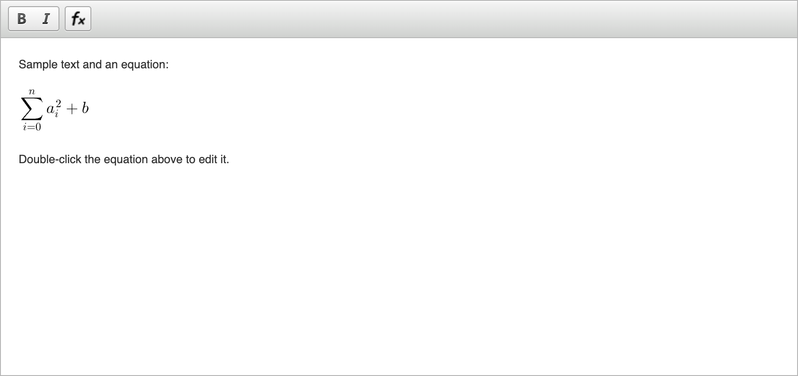
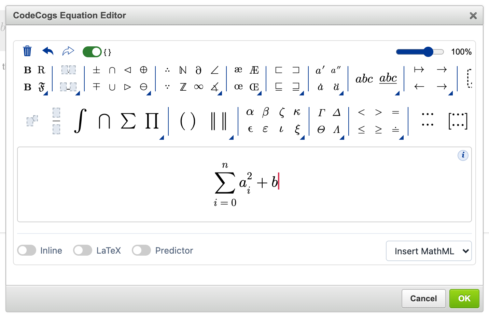

# fxEditor for CKEditor 4

The fxEditor plugin for [CKEditor 4](https://ckeditor.com/ckeditor-4/) adds an **fx** button to
the editor's toolbar. It opens fxEditor, CodeCogs' equation editor, in a dialog: a toolbar of
symbols and structures, a maths view you type into directly, and a LaTeX view that stays in step
with it. The equation is inserted at the cursor as MathML (the default) or as an SVG image,
chosen in the dialog. Double-click an inserted equation to edit it again (or, in a CKEditor
build that includes the context menu, right-click it and choose **Edit Equation**).

It is for sites still running CKEditor 4. On a newer version, use the
[CKEditor 5 plugin](https://github.com/willzyba/ckeditor_v5).

## What is in this repository

**CKEditor 4 itself is the work of [CKSource](https://ckeditor.com), under its own licence.**
This repository is the complete CKEditor 4.5.4 download, bundled as CKSource distributes it, with
the fxEditor plugin added. CKEditor's own readme is [CKEDITOR-README.md](CKEDITOR-README.md), and
its licence is [LICENSE.md](LICENSE.md).

Only these parts are CodeCogs' work:

- [`plugins/eqneditor/`](plugins/eqneditor/) - the fxEditor plugin
- [`example.html`](example.html) - the example page
- the line in [`config.js`](config.js) that loads the plugin (`config.extraPlugins = 'eqneditor';`)
- this README and the `screenshots/` folder

## Screenshots



*The fx button on CKEditor 4's toolbar.*



*fxEditor open in a CKEditor 4 dialog.*

## Links

- [Documentation and live demo](https://fxplugins.codecogs.com/docs/ckeditor4.html)
- [Customise and download](https://fxplugins.codecogs.com/docs/ckeditor4.html#customise) - design
  the editor's look and download the result
- [All fxEditor plugins](https://fxplugins.codecogs.com)
- [fxEditor](https://fxeditor.codecogs.com)

## Installing from git

```bash
git clone https://github.com/willzyba/ckeditor_v4.git
```

**If you already have CKEditor 4**, copy the plugin's folder, `plugins/eqneditor`, into your
CKEditor's own `plugins` folder. The plugin needs CKEditor's `dialog` plugin, which standard
CKEditor 4 builds include.

**If you do not**, the clone is itself a working CKEditor 4.5.4 (CKSource's "basic" build) with
the plugin in place: serve the folder from your site and load its `ckeditor.js`. Its
[`config.js`](config.js) already loads the plugin, and removes the Undo and Redo buttons, among
others, through `config.removeButtons`.

Then load the plugin, add `EqnEditor` to your toolbar, and give it your licence key:

```js
CKEDITOR.replace( 'editor1', {
    extraPlugins: 'eqneditor',
    toolbar: [ [ 'Bold', 'Italic' ], [ 'EqnEditor' ], [ 'Undo', 'Redo' ] ],
    eqneditor_licence: 'YOUR-FXEDITOR-LICENCE-KEY',   // from fxeditor.codecogs.com/purchase
    eqneditor_design: { colour: '#0f7a4d' }           // optional
} );
```

The equation editor itself is fetched from `fxtex.codecogs.com` the first time it is needed, so
you always get the current editor.

To use it: click where the equation should go, click **fx**, build the equation, choose how it
is inserted from **Insert as**, then **OK**.

MathML needs a stylesheet on the page that displays it. On the page that finally shows your
content, add:

```html
<link rel="stylesheet" href="https://fxtex.codecogs.com/fxtex.css">
```

### Trying the example

[`example.html`](example.html) is the page used for the live demo. Before opening it, replace its
two placeholders: `{{EQN_SERVER}}` with `fxtex.codecogs.com` and `{{FXTEXPRO_KEY}}` with your
licence key. The documentation site fills these in when it publishes the demo.

## Licence key

Equations are rendered by fxTeX Pro, which needs a licence key for your domain. Without one,
equations show the reason they cannot render in place of the maths.

Get your licence key from [fxeditor.codecogs.com/purchase](https://fxeditor.codecogs.com/purchase).

The key goes in the `eqneditor_licence` configuration option.

### Options

| Option | Default | Meaning |
|---|---|---|
| `eqneditor_licence` | | Your fxEditor licence key. Required. |
| `eqneditor_design` | | The editor's look: dialog width, height and scale, toolbar panels and size, colour, equation and markup sizes, undo/redo, how the dialog opens. Build one in [Customise and download](https://fxplugins.codecogs.com/docs/ckeditor4.html#customise). |
| `eqneditor_server` | `'fxtex.codecogs.com'` | Host the equation editor's own code is loaded from. A bare host means https; a full origin is used as it is. |
| `eqneditor_render_url` | `'https://fxtex.codecogs.com'` | The rendering service for equations inserted as images. Point it at a self-hosted fxTeX Server to keep equations inside your network. |
| `eqneditor_script_url` | from `eqneditor_server` | Full URL of the equation editor bundle. |
| `eqneditor_css_url` | from `eqneditor_server` | Full URL of the equation editor stylesheet. |

## Licence

- **CKEditor 4** - Copyright CKSource - Frederico Knabben. Licensed, at your choice, under the
  GPL 2 or later, the LGPL 2.1 or later, or the MPL 1.1 or later. See [LICENSE.md](LICENSE.md),
  which also lists the third-party libraries CKEditor includes.
- **The fxEditor plugin** (`plugins/eqneditor/`) and `example.html` - Copyright (c) 2026 CodeCogs, Zyba
  Ltd. Released under the MIT licence - see
  [`plugins/eqneditor/LICENSE`](https://github.com/willzyba/ckeditor_v4/blob/main/plugins/eqneditor/LICENSE).
- fxEditor and fxTeX Pro need their own licence key, as above.
